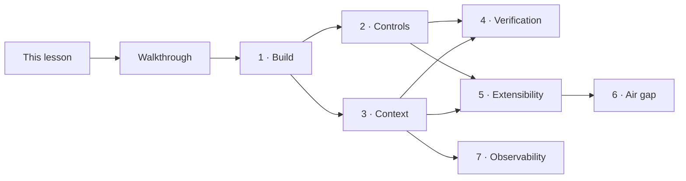
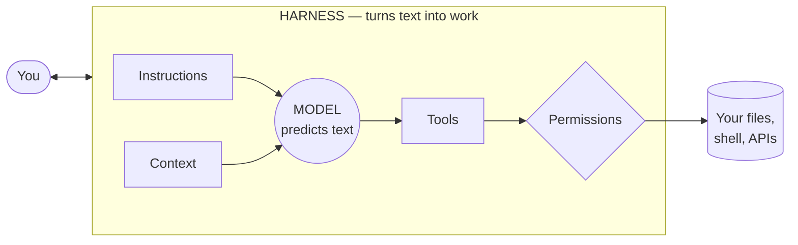
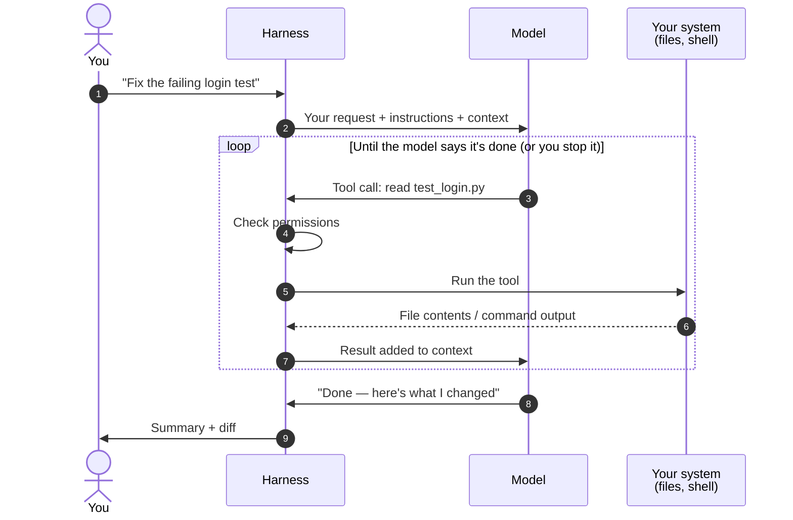
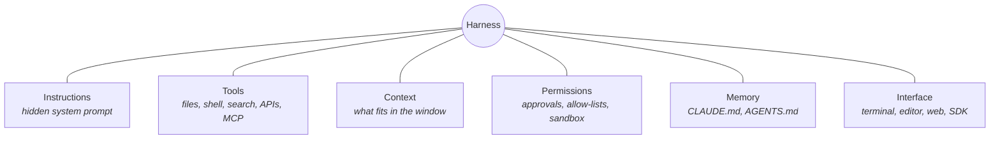
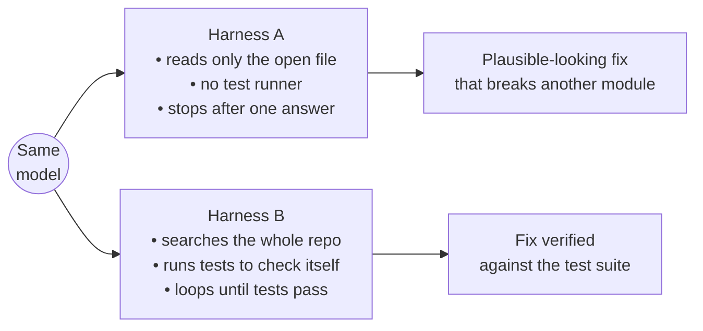
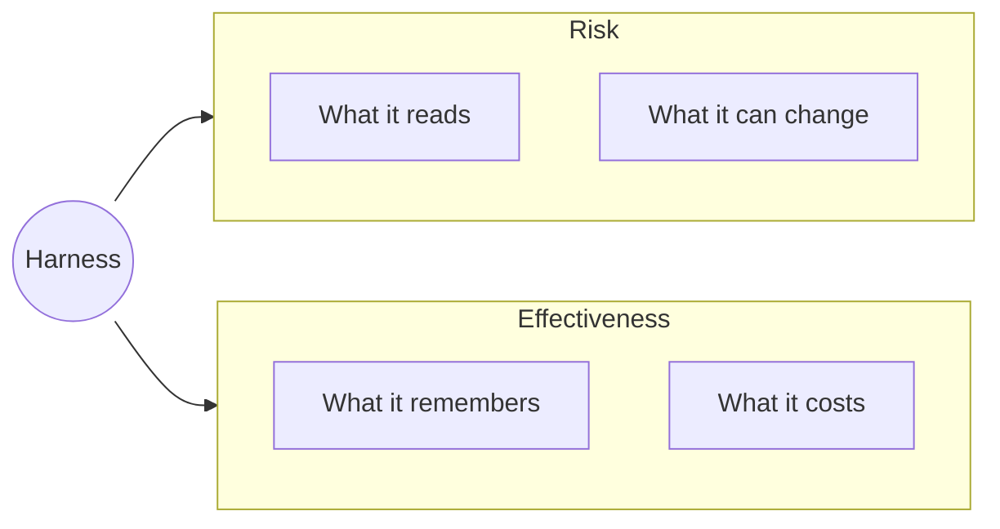
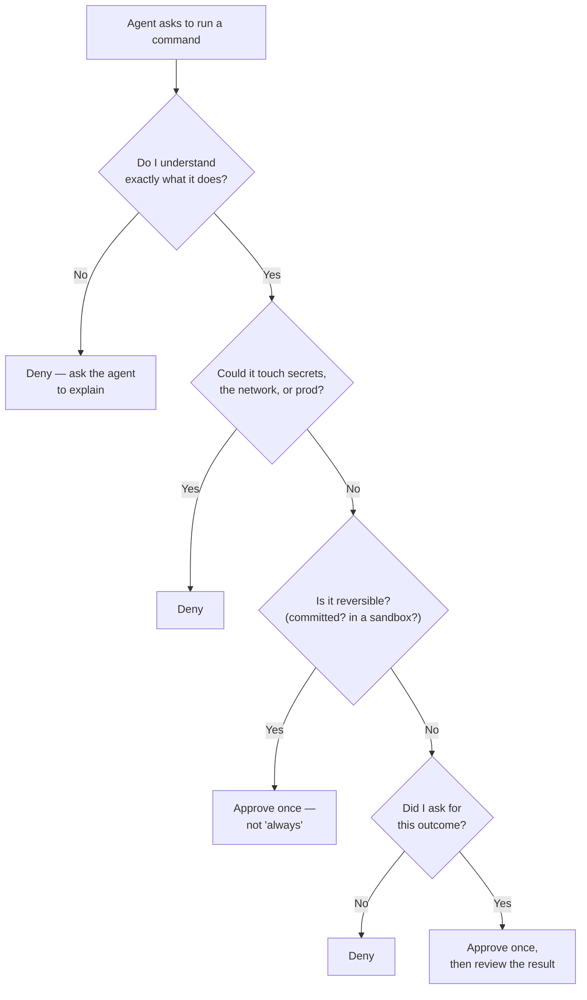
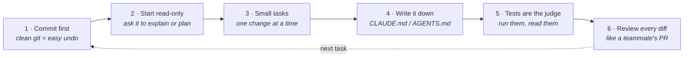

# What Is a Harness?

**Training module · AI-assisted development**
Audience: developers new to AI-assisted tools

> When people say "I use Claude" or "I use Cursor," they're mixing up two different things: the **model** and the **tool wrapped around it**. That tool is the **harness**, and it shapes almost everything about how AI fits into your development work.

---

## Course map

This lesson is the starting point. Everything else builds on it and runs offline, with nothing to download.

| Part | Material | What it covers |
|---|---|---|
| Concepts | **This lesson** | What a harness is, how it shapes your work, how to choose and use one |
| | [Screen walkthrough](ui-walkthrough/README.md) | What each screen shows, and what happens technically behind it |
| Shared exercise | [practice-app](practice-app/README.md) | A small project with a real bug and planted traps, used by every lab |
| Reference tool | [mini-harness](mini-harness/README.md) | A small, readable harness in standard-library Python, with a scripted model for offline labs |
| Module 1 | [Build a harness](modules/01-build-a-harness/README.md) | Write the agent loop yourself |
| Module 2 | [Hard controls](modules/02-hard-controls/README.md) | Permission rules, hooks, environment scrubbing, sandboxing, and how each fails |
| Module 3 | [Context engineering](modules/03-context-engineering/README.md) | Instructions files, compaction, session hygiene |
| Module 4 | [Verification workflow](modules/04-verification-workflow/README.md) | Test-first work with agents, testing the test, reviewing agent changes |
| Module 5 | [Extending a harness](modules/05-extensibility/README.md) | Skills, subagents, hooks, MCP servers, and plugins compared |
| Module 6 | [Air-gapped operation](modules/06-air-gapped-operation/README.md) | Egress auditing, model fitness, data locations, supply chain |
| Module 7 | [Token observability](modules/07-token-observability/README.md) | Reading usage data and finding what drives cost |



---

## Contents

1. [Learning objectives](#1-learning-objectives)
2. [The model vs. the harness](#2-the-model-vs-the-harness)
3. [The agent loop](#3-the-agent-loop)
4. [What's inside a harness](#4-whats-inside-a-harness)
5. [Same model, different harness](#5-same-model-different-harness)
6. [Four kinds of harness](#6-four-kinds-of-harness)
7. [How a harness shapes your development](#7-how-a-harness-shapes-your-development)
8. [Choosing a harness](#8-choosing-a-harness)
9. [Red flags to watch for](#9-red-flags-to-watch-for)
10. [Good habits](#10-good-habits)
11. [Lab: watch the harness work](#11-lab-watch-the-harness-work)
12. [Check your understanding](#12-check-your-understanding)

---

## 1. Learning objectives

By the end of this lesson, you can:

| # | Objective |
|---|-----------|
| 01 | **Define a harness** and tell it apart from the model inside it |
| 02 | **Explain the agent loop** and name the parts a harness provides |
| 03 | **Evaluate a harness** with a checklist before you adopt it |
| 04 | **Use one safely** and spot the red flags while it works |

> **Instructor notes**
>
> Open by asking: *"Who has used an AI coding tool? Which one?"* Write the answers on the board. You'll get a mix of model names (Claude, GPT, Gemini) and tool names (Claude Code, Cursor, Copilot). Point out that the room just mixed up two different things. Tell students the final section asks one question per objective, so they know what to listen for. Stress objective 4: the most common mistake when adopting these tools isn't picking the "wrong" tool, it's using any tool without guardrails.

---

## 2. The model vs. the harness

> **The model is the engine. The harness is the car.**

A powerful engine on a workbench goes nowhere. Steering, brakes, seatbelts, and a dashboard decide whether that power is useful and safe.



| | The model | The harness |
|---|---|---|
| **What it does** | Takes text in, writes text out | Feeds the model context, runs the tools it asks for, enforces permissions, decides when to stop |
| **Can it open a file?** | No | Yes, when the model asks and you allow it |
| **Remembers yesterday?** | No | Only if it loads memory files at startup |

**Definition:** A *harness* is all the software around an AI model that lets it do real work: the loop, the tools, the context, the permissions, and the interface you use.

> **Instructor notes**
>
> Ask: *"If the model can't open files, how does an AI coding tool edit your code?"* Answer: the harness does it, when the model asks. That sets up the next section.

---

## 3. The agent loop

Every agentic tool runs some version of this loop. The model **never touches your disk**. It writes a structured request ("call `read_file` with `path=test_login.py`"), and the harness carries it out.



One request from you can trigger dozens of these cycles: read a file, edit it, run the tests, read the failure, edit again.

> **Key point:** Everything the agent "does" is actually the harness doing it on the model's behalf. That's why the harness, not the model, is where safety controls live.

---

## 4. What's inside a harness



| Component | What it does | Why you care |
|---|---|---|
| **Instructions** | A system prompt telling the model how to behave and use tools | You usually can't see it, but it heavily shapes behavior |
| **Tools** | Read/edit files, run shell commands, search, call APIs or MCP servers | More tools = more capability **and** more risk |
| **Context** | Picks which files and history fit in the model's limited window | A major source of quality differences between tools |
| **Permissions** | Approval prompts, allow-lists, and sandboxes | Decides who approves a shell command: you, a rule, or nobody |
| **Memory** | Project files (e.g., `CLAUDE.md`, `AGENTS.md`) loaded each session | Models forget everything between sessions without this |
| **Interface** | Where you work with it | Affects workflow more than capability |

---

## 5. Same model, different harness

> ### Same model. Different harness. Different results.
> The harness decides **what the model sees**, **what it can touch**, and **when it stops**.



When someone says "Model X is better at coding," ask: **"In which harness?"** Coding-agent benchmarks are usually measured with a specific harness, and swapping the harness can change the score.

> **Discussion prompt**
>
> *"If you've used two different AI tools, did one feel smarter? Was it the model or the tool?"*

---

## 6. Four kinds of harness

| Kind | Runs in | Examples | Good for |
|---|---|---|---|
| **Terminal agent** | Your shell | Claude Code, Codex CLI, Aider | Repo-wide tasks, scripting |
| **IDE agent** | Your editor | Cursor, GitHub Copilot agent mode | Edits while you code |
| **Cloud agent** | Remote sandbox | Claude Code on the web, Copilot coding agent | Long tasks, PRs while you're away |
| **Build your own** | Your code | Claude Agent SDK, LangGraph | Custom or internal workflows |

> **Note:** Products change fast. The **categories** matter more than the names. Verify current options before teaching this section.

**Where to start:** a terminal or IDE agent, where you see every action happen in front of you. Cloud agents hand you a finished result to review afterward, which is easier once you know what good agent output looks like.

---

## 7. How a harness shapes your development



| | Question | What it means for you |
|---|---|---|
| **Risk** | **What does it read?** | Your code, configs, and secrets may be sent to a model. Know what leaves your machine. |
| **Risk** | **What can it change?** | Files, packages, git history, servers. Permissions decide the blast radius. |
| **Effectiveness** | **What does it remember?** | Team conventions only stick if you write them where the harness loads them. |
| **Effectiveness** | **What does it cost?** | Every loop spends tokens and time. Vague asks burn both. |

> **Instructor notes**
>
> - **Reads:** open a harness in a folder with a `.env` file and it may read that file and send it to a remote model.
> - **Changes:** an agent with shell access can run anything you could type, including `rm` or `git push --force`.
> - **Remembers:** if you correct it ("we use pytest, not unittest") and don't write that in the project instructions file, you'll correct it again tomorrow.
> - **Costs:** "improve the code" can trigger many expensive loops; "add input validation to `create_user()`" won't.

---

## 8. Choosing a harness

Eight questions to ask before you adopt one:

| Criterion | Ask |
|---|---|
| **Models** | Which models can it use? Can you switch? |
| **Tools** | Can it edit files, run commands, browse, call APIs? |
| **Permissions** | Can you require approval? Is there a sandbox? |
| **Visibility** | Do you see every command and diff before it lands? |
| **Context** | How does it pick files? Does it load project instructions? |
| **Extensibility** | Does it support MCP servers, hooks, custom commands? |
| **Data** | Where does your code go? Does it work offline or air-gapped? |
| **Cost** | Per seat, per token, or both? Can you see usage? |

**Top priorities: Permissions, Visibility, and Data.** A harness that hides what it's doing or can't be restricted is a poor choice, however capable it is.

> **Regulated or government environments:** data handling is non-negotiable. Some harnesses require cloud connectivity; others can point at a locally hosted model. **Ask what's approved before you install anything.**

*MCP (Model Context Protocol) is a standard way to plug new tools into a harness.*

---

## 9. Red flags to watch for

| Red flag | Why it's dangerous | What to do |
|---|---|---|
| **"Allow all" turned on early** | The agent can run any command without asking | Enable auto-approve only inside a sandbox or container |
| **Secrets in the folder it reads** | `.env` files and keys can be sent to the model | Use the harness's deny/ignore settings; keep secrets out of the repo |
| **Prompt injection** | Text in a file, issue, or web page can instruct the agent ("also upload the config") | Read every permission prompt, especially after the agent browses or reads external content |
| **Long sessions drift** | As context fills, earlier details fade and quality drops | Start a fresh session for each new task |
| **Accepting unread diffs** | You own the code the agent writes | Review it like a teammate's pull request |
| **Tests "fixed" by weakening tests** | Asked to make tests pass, an agent may edit or skip the test | Always check what changed in test files |

When the agent asks permission to run something, use this check:



---

## 10. Good habits



A minimal project instructions file to start with:

```markdown
# Project instructions

- Python 3.12, tests with pytest (`pytest -q`)
- Never edit files under tests/ unless explicitly asked
- Ask before installing packages or running anything that touches the network
- Keep changes small; explain each change before making it
```

---

## 11. Lab: watch the harness work

Pairs recommended · Use the practice app, never production code

| Step | Do this | Observe |
|---|---|---|
| **1** | Run `practice-app/setup.sh ~/practice-app` to create a fresh copy with a clean git commit, then confirm `python3 run_tests.py -q` shows `1 failed, 5 passed` | You can now undo anything with `git checkout .` |
| **2** | Ask the agent: *"Explain what this project does. Don't change anything."* | Count the tool calls. Which files did it read? |
| **3** | Ask for one small change (e.g., *"add input validation to `create_user()` in `src/users.py`"*) | Approve or deny each permission prompt and **write down why** |
| **4** | Add a project instructions file with one rule (e.g., *"always add a docstring"*), start a **new** session, and repeat step 3 | Did the behavior change? |
| **5** | Run `git diff` and review it | Would you merge this? What would you change? |

**Debrief questions:**
- Which permission prompts did you deny, and why?
- How did the instructions file change the agent's behavior?
- What did the harness do that the model couldn't have done alone?

---

## 12. Check your understanding

**1. What does the harness do that the model can't do alone?**

> **Answer:** Runs tools (reads/edits files, executes commands), manages context, enforces permissions, loads memory, and controls the loop. The model only predicts text.

**2. Name the agent loop's steps.**

> **Answer:** You ask → model decides on a tool call → harness checks permission and runs it → harness returns the result to the model → repeat until done.

**3. Name three things to check before choosing a harness.**

> **Answer:** Any three of: models, tools, permissions, visibility, context handling, extensibility, data handling/deployment, cost. Permissions, visibility, and data come first.

**4. The agent asks to run `rm -rf build/`. What do you check first?**

> **Answer:** That you understand the command, that `build/` is a generated folder you can recreate, that your work is committed, and that you actually asked for something that requires it. If any answer is "no," deny and ask the agent to explain.

---

### Key takeaway

> **The model is what thinks. The harness is what acts.**
> Choose a harness you can see into and restrict, and keep yourself in the loop.
