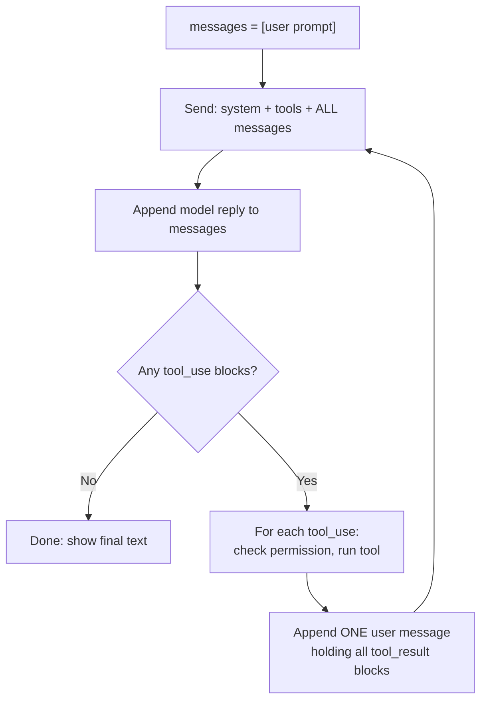

# Module 1: Build a Harness

**Prerequisites:** [What Is a Harness?](../../README.md) and the [screen walkthrough](../../ui-walkthrough/README.md)

You've seen what a harness looks like from the outside. In this module you write the core of one: the loop that turns a model's text into actions. It's about 60 lines of Python. Once you've written it, every behavior covered in the rest of the course (permissions, compaction, token growth, prompt injection) becomes something you can point to in code.

## Learning objectives

By the end of this module, you can:

1. Write an agent loop that sends requests, runs requested tools, and returns results.
2. Explain why each request is larger than the last.
3. Show exactly where a harness enforces permissions, and where it can't.
4. Read a raw request body and say what the model sees.

---

## 1. The whole loop on one page



Five facts about this loop drive everything else in the course:

| Fact | Consequence |
|---|---|
| The model is stateless; the harness re-sends **all** messages every time | Each request is bigger than the last. Cost and context use grow as the session goes on (Module 7) |
| The model returns *requests* for tools, never results | Every action happens in harness code, as your user. That's where controls belong (Module 2) |
| Tool results become ordinary text in the conversation | Anything a tool reads can steer the model: prompt injection |
| The loop ends only when the model stops asking for tools | A confused model can loop; real harnesses cap the number of steps |
| The harness decides which tools exist | The model can ask for a tool that isn't there; the harness has to answer anyway |

---

## 2. The exercise

The exercise uses the [mini-harness](../../mini-harness/README.md) folder and the [practice app](../../practice-app/README.md). Everything runs offline. The model is a **mock** that replays a scripted session, so you can focus on the loop without needing a model endpoint.

### Step 1: Set up

```bash
cd practice-app && ./setup.sh ~/practice-app && cd ../mini-harness
```

### Step 2: Run the unfinished loop

```bash
python3 exercise/loop.py ~/practice-app scenarios/investigate.json
```

You'll see 20 requests, all the **same size**, and no tools running. The request size is your first diagnostic: if it never grows, the history isn't being sent back.

### Step 3: Fill in the TODOs

Open `exercise/loop.py`. Each TODO is one or two lines:

| TODO | What to write | Why it matters |
|---|---|---|
| 1 | Start `messages` with `{"role": "user", "content": prompt}` | The conversation is just a list the harness owns |
| 2 | Append `{"role": "assistant", "content": response["content"]}`; print text blocks | The model's own words become part of what it sees next time |
| 3 | Collect blocks where `type == "tool_use"`; `break` if there are none | This is the loop's only exit condition |
| 4 | Build a `tool_result` for each call (matching `tool_use_id` to the call's `id`), then append them all as **one** user message | The IDs pair each result with its request; the model sees results as coming from the "user" side |
| 5 | In `run_tool`, ask with `input()` before running a command | The simplest possible hard control |

### Step 4: Run it again

```bash
python3 exercise/loop.py ~/practice-app scenarios/investigate.json
```

Expected output (abridged):

```text
[request 1] ~124 input tokens
model: I'll start by reading the failing test and running it.
tool:  read_file({"path": "tests/test_login.py"})
[request 2] ~438 input tokens
tool:  run_command({"command": "python3 run_tests.py -q", ...})
  allow `python3 run_tests.py -q`? [y/N] y
[request 3] ~655 input tokens
model: The empty-hash test fails. Let me find verify_password.
tool:  search({"pattern": "def verify_password", "path": "src"})
[request 4] ~744 input tokens
...
```

If you get stuck, compare with `solutions/loop_solution.py`.

### Step 5: Read what happened

Answer these from the output before moving on:

1. **Why did request 2 jump from ~124 to ~438 tokens?** The whole test file (a tool result) is now in the history, and it's re-sent on every request from here on.
2. **The model called `search`, but your harness only has `read_file` and `run_command`. What happened?** Your `run_tool` returned `Unknown tool: search`, and that text went back to the model as a result. Models can request tools that don't exist, or call real tools with bad arguments. The harness must always answer with *something*, and that answer becomes context.
3. **If you answered "n" at the permission prompt, what did the model receive?** The string `Permission denied by user.` A denial isn't an exception; it's information the model reasons about next.

---

## 3. See the real request bodies

The reference harness can print every request it sends:

```bash
python3 harness.py --workdir ~/practice-app --scenario scenarios/investigate.json \
    --show-requests --prompt "Why is the login test failing?"
```

Look at the last request printed. Find:

- the **system prompt** (instructions, environment details, and any `AGENTS.md` contents),
- the **tool list** (sent every time, even if unused),
- each **tool_result**, with the full contents of every file read so far.

That last request is the most important artifact in this module. It is *everything* the model knows. Nothing outside it exists for the model.

---

## 4. From your loop to a real harness

Your loop works, but a production harness adds a layer at almost every line. `harness.py` is your loop with these layers added. Find each one:

| Layer | In `harness.py` | Covered in |
|---|---|---|
| Permission rules and hooks before every tool | `Harness.authorize()`, `Policy.check()`, `Policy.run_hooks()` | Module 2 |
| Path checks so file tools stay in the working directory | `Harness.resolve()` | Module 2 |
| Splitting compound shell commands before matching rules | `split_command()` | Module 2 |
| Loading `AGENTS.md` into the system prompt | `Harness.build_system()` | Module 3 |
| Dropping old tool output when context fills | `Harness.compact()` | Module 3 |
| Truncating huge command output | `tool_run_command()` | Module 3 |
| A diff preview before edits | `Harness.preview_edit()` | Module 4 |
| Logging every request's token usage | `Harness.log()`, `/usage`, `/context` | Module 7 |
| A cap on loop iterations | `--max-steps` | This module |

---

## 5. Optional: connect a real model

If your environment has a model endpoint (see your environment setup lesson for its address and credentials), run the reference harness against it:

```bash
export MINI_HARNESS_API_KEY=<your key>
python3 harness.py --workdir ~/practice-app \
    --backend openai --base-url <endpoint>/v1 --model <model-name> \
    --prompt "The login test is failing. Find out why, but don't change anything yet."
```

Use `--backend anthropic` if the endpoint speaks the Anthropic Messages API, and `--ca-file` if it uses an internal certificate authority. Compare the real session with the scripted one. A real model reads each tool result and adapts; the mock doesn't. A real model may also take a different path, call tools you didn't expect, or stop early.

---

## Check your understanding

**1. Your loop's request size stays flat across turns. What's wrong?**

> **Answer:** The model's replies or the tool results aren't being appended to `messages`, so every request sends the same history. The model is effectively starting over each time.

**2. Where in your loop is the only place a safety control can actually stop an action?**

> **Answer:** Between receiving a `tool_use` block and running the tool, in `run_tool`. The model has already decided by then; the harness decides whether it happens.

**3. Why does the harness send tool results as a "user" message?**

> **Answer:** The API has only two conversational roles. Results come from outside the model, so they go on the user side, paired to requests by ID. It's also why the model can't reliably tell instructions you wrote from text a tool returned: both arrive on the same side of the conversation.

**4. A teammate says "the model ran `rm` on my files." Who actually ran it?**

> **Answer:** The harness, on the model's request, as the teammate's user account. The question to ask is why the harness allowed it: a rule, an "always allow," or an approval they gave.

---

### Key takeaway

> **The loop is simple. The safety, cost, and quality of a harness come from everything wrapped around it.**
