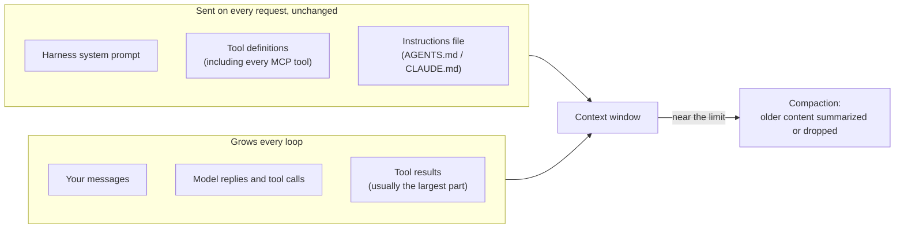
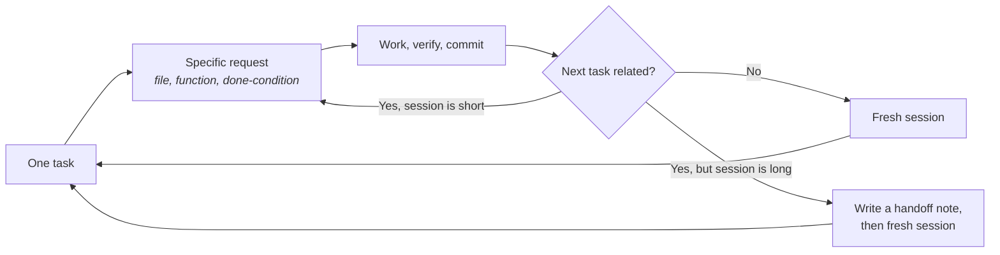

# Module 3: Context Engineering

**Prerequisites:** [Module 1](../01-build-a-harness/README.md)

The model knows only what's in the request. "Context engineering" is the practice of deciding what goes into that request: which instructions, which files, how much history, and what gets dropped when it fills up. It affects quality, cost, and safety more than almost any other choice you make while using a harness.

## Learning objectives

By the end of this module, you can:

1. List what fills the context window, and measure each part.
2. Write a short, effective instructions file, and explain what doesn't belong in it.
3. Explain what compaction loses, and keep sessions short enough to avoid relying on it.
4. Hand work off between sessions without losing the important parts.

---

## 1. What fills the window

Every request carries the same fixed overhead plus a history that only grows.



| Part | Typical size | Who controls it |
|---|---|---|
| Harness system prompt | Fixed per harness | The vendor |
| Tool definitions | Grows with every tool and MCP server you add | You (Module 5) |
| Instructions file | Whatever you write, on **every** request | You |
| Tool results | Unbounded: every file read, every command output | You, through what you ask for |

Two consequences:

- **Fixed overhead is multiplied by the number of requests.** A 1,000-token instructions file in a 40-request session is 40,000 input tokens.
- **Tool results accumulate.** A broad request ("review the whole codebase") fills the window with file contents, and the details you care about compete with everything else.

---

## 2. Lab A: Measure the cost of an instructions file

This lab uses two example files in [`examples/`](examples/):

- [`AGENTS.md`](examples/AGENTS.md): 17 lines. Commands, layout, and rules.
- [`AGENTS-bloated.md`](examples/AGENTS-bloated.md): 134 lines. History, style rules a linter should enforce, two procedures only needed occasionally, repeated warnings, and an FAQ.

From the `mini-harness` folder, run the same scenario three times on fresh copies: with no instructions file, with the short one, and with the bloated one (copy it in as `AGENTS.md`).

```bash
../practice-app/setup.sh ~/lab3a
cp ../modules/03-context-engineering/examples/AGENTS.md ~/lab3a/
python3 harness.py --workdir ~/lab3a --scenario scenarios/investigate.json --prompt "Why is the login test failing?"
```

Check the banner: it should say `loaded: AGENTS.md (17 lines)`. Then compare the usage logs (`~/lab3a/.mini-harness/usage.jsonl`). Our results with the mock model (estimated tokens):

| Instructions file | First request | Whole 5-request session |
|---|---|---|
| None | ~400 | ~4,300 |
| Short (17 lines) | ~600 | ~5,300 |
| Bloated (134 lines) | ~3,050 | ~17,600 |

The bloated file quadrupled the session's input, and a real session runs far more than five requests. It also hurt quality in ways the numbers don't show: the one rule that mattered ("never modify tests") is buried among dozens of style rules and repeated warnings, and the model weighs all of it equally.

### What belongs in an instructions file

| Put it in | Leave it out |
|---|---|
| How to build, test, and run (exact commands) | History and background narrative |
| Where things are, in a few lines | Rules a linter or formatter already enforces |
| Constraints that prevent damage ("never edit `vendor/`") | Procedures used occasionally (release steps, migrations): make them skills (Module 5) |
| What "done" means for a task | Anything secret: the file goes to the model on every request |
| Things the agent repeatedly gets wrong | Repetition and emphasis ("seriously, do not…") |

And remember from the walkthrough: **an instructions file is a soft control.** "Never read `.env`" belongs in it so the model doesn't try, but the deny rule from Module 2 is what stops it.

---

## 3. Lab B: Watch compaction lose information

Run the long-session scenario with a deliberately small context limit:

```bash
../practice-app/setup.sh ~/lab3b
python3 harness.py --workdir ~/lab3b --scenario scenarios/long-session.json \
    --context-limit 2500 --prompt "Review the whole project."
```

You'll see lines like `[compacted context: ~2075 -> ~1199 tokens]` as the harness removes older tool results to stay under the limit. By the end, the first files the agent read are gone from the conversation; only the model's own earlier comments about them remain.

Now run it interactively to see the breakdown:

```bash
python3 harness.py --workdir ~/lab3b --scenario scenarios/long-session.json --context-limit 2500
> Review the whole project.
> /context
```

`/context` shows how much of the window is system prompt, tool definitions, messages, and tool results. In most real sessions, tool results dominate.

**What compaction costs you:**

- Exact text (line numbers, error messages, the precise wording of an early instruction) is replaced by a summary or removed.
- The model can't tell what it has forgotten. It may confidently "remember" a detail that was summarized away.
- Prompt-injection text in a compacted tool result may survive as paraphrase. Compaction doesn't make injected text safe.

---

## 4. Session hygiene

The best way to manage compaction is to rarely need it.



**Be specific.** "Improve the code" makes the agent read everything. "Add input validation to `create_user()` in `src/users.py`: reject empty names and passwords with `ValueError`; done when a new test passes" reads two files.

**One task per session.** Old context from task A wastes tokens and attention during task B. Clearing is free; carrying stale context costs on every request.

**Hand off in writing.** When a task spans sessions, ask the agent to write the state to a file before you clear, then start the next session by pointing at it:

```markdown
# HANDOFF: login validation work

## Done
- Fixed empty-hash bug in src/auth.py (commit a1b2c3d); all tests pass.

## In progress
- create_user() validation: tests written in tests/test_users_and_audit.py, implementation not started.

## Decisions
- Raise ValueError (not return None) for invalid input; agreed with reviewer.

## Next step
- Implement validation in src/users.py until the new tests pass.
```

A handoff file is short, exact, and written while the details are still in context: the opposite of an automatic summary written when the window is already full.

---

## 5. In a production harness

In Claude Code:

| Concept | How it appears |
|---|---|
| Instructions file | `CLAUDE.md`, loaded at session start (project, user, and organization levels). Other harnesses read `AGENTS.md`; check what yours loads |
| Measure context | `/context` shows what's using the window; `/usage` shows session tokens |
| Clear | `/clear` starts fresh with no history |
| Compaction | Automatic near the limit; `/compact <focus>` compacts now with instructions on what to keep. A "Compact instructions" section in `CLAUDE.md` guides automatic compaction |
| Re-inject after compaction | A `SessionStart` hook with the `compact` matcher can print critical reminders back into context after every compaction |
| Move procedures out | Skills load their full text only when used, so occasional procedures cost almost nothing until needed (Module 5) |
| Keep verbose work out | Subagents run in their own context and return only a summary |

The Claude Code documentation recommends keeping `CLAUDE.md` under about 200 lines and moving specialized workflows into skills, for exactly the reasons Lab A demonstrates.

---

## Check your understanding

**1. Your instructions file is 1,500 tokens. A session makes 60 requests. How many input tokens does the file cost?**

> **Answer:** About 90,000, because it's sent on every request. Prompt caching (Module 7) can make repeated content cheaper, but it still occupies the window every time.

**2. Why is a release procedure better as a skill than in the instructions file?**

> **Answer:** It's needed occasionally. In the instructions file it costs tokens and attention on every request of every session; as a skill, only a short description is always present, and the full text loads when it's used.

**3. After a long session, the agent says the bug was "on line 14 of auth.py." It's actually on line 18. What likely happened?**

> **Answer:** The original file contents were compacted away, and the model is working from a summary or its own earlier paraphrase. Have it re-read the file, or start a fresh session with a handoff note.

**4. What's the difference between a handoff note and compaction?**

> **Answer:** You decide what a handoff note says, and it's written while the details are still in context. Compaction decides for you, at the point when the window is already too full to keep everything.

---

### Key takeaway

> **Every token in the request competes for the model's attention and your budget. Keep the fixed part short, the sessions focused, and the handoffs written.**
