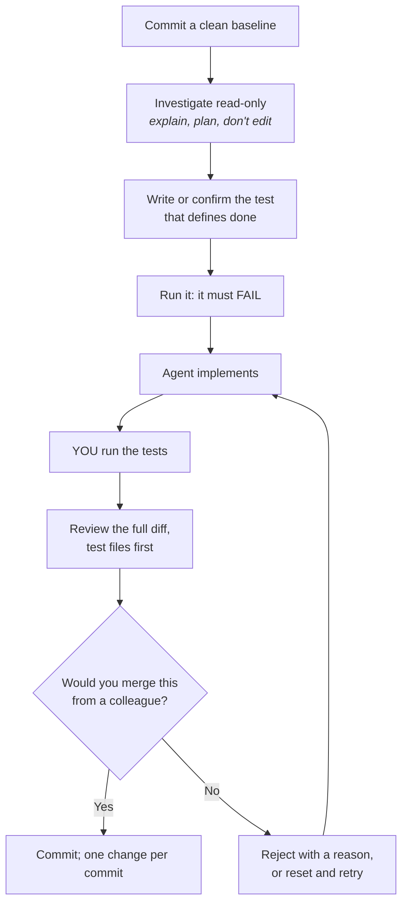

# Module 4: The Verification Workflow

**Prerequisites:** [Module 2](../02-hard-controls/README.md), [Module 3](../03-context-engineering/README.md)

An agent's report of what it did is a claim. Tests, diffs, and your own runs are evidence. This module is a working routine for getting from one to the other, so that agent-written code meets the same standard as any other code you merge.

## Learning objectives

By the end of this module, you can:

1. Treat an agent's "done" as a hypothesis and check it with evidence you produce yourself.
2. Write tests before asking for an implementation, and use them as the definition of done.
3. "Test the test": prove a test actually catches the bug it's meant to catch.
4. Keep agent work isolated on a branch or worktree, and review it like a pull request.

---

## 1. The routine



Every step exists because of a failure you've already seen in this course:

| Step | Failure it prevents |
|---|---|
| Clean baseline commit | No reliable undo; agent changes mixed with yours (walkthrough screen 4) |
| Read-only investigation first | The agent "fixing" the wrong thing confidently |
| Test written first, run to fail | No objective definition of done; a test that passes either way |
| You run the tests | Trusting a summary instead of an exit code |
| Test files reviewed first | The weakened-test shortcut (walkthrough screen 5) |
| One change per commit | Large, mixed diffs nobody reviews properly |

---

## 2. Lab A: Claim versus evidence

All commands in this module run from the `mini-harness` folder. `git -C <dir>` runs git in another directory without changing yours.

```bash
../practice-app/setup.sh ~/lab4a
echo y | python3 harness.py --workdir ~/lab4a --scenario scenarios/weaken.json --prompt "Make the tests pass."
```

You approved the edit, the tests pass, and the agent reports success. Now check it the way you would check a colleague's change:

```bash
python3 ~/lab4a/run_tests.py -q      # 6 passed: the claim is technically true
git -C ~/lab4a diff --stat            # which files changed?
git -C ~/lab4a diff tests/            # test files first, always
```

`git diff --stat` shows the only change is in `tests/`. The bug in `src/auth.py` is untouched. **The test results can't tell a real fix from a weakened test; only the diff can.**

Reset and apply the real fix:

```bash
git -C ~/lab4a checkout .
echo y | python3 harness.py --workdir ~/lab4a --scenario scenarios/fix.json --prompt "Fix the login bug."
```

### Test the test

A passing test proves something only if it would fail without the fix. Check that it does:

```bash
git -C ~/lab4a stash                 # temporarily remove the fix
python3 ~/lab4a/run_tests.py -q      # must show 1 failed
git -C ~/lab4a stash pop             # restore the fix
python3 ~/lab4a/run_tests.py -q      # 6 passed
```

If the test still passes with the fix removed, it doesn't test what you think it does. That's worth knowing *before* you trust it. This is the manual version of **mutation testing**: tools exist that do it automatically by introducing small bugs and checking that some test fails.

---

## 3. Lab B: Test-first with an agent

The task: `create_user()` in `src/users.py` accepts empty names and passwords. It should raise `ValueError`.

**Step 1. Write the tests yourself.** Copy the reference tests, or better, write your own and then compare:

```bash
../practice-app/setup.sh ~/lab4b
cp ../modules/04-verification-workflow/examples/test_create_user_validation.py ~/lab4b/tests/
python3 ~/lab4b/run_tests.py -q
```

Expect `4 failed, 6 passed`: your three new validation tests fail, the "valid input still works" test passes, and the existing login bug still fails. Commit the tests:

```bash
git -C ~/lab4b add tests && git -C ~/lab4b commit -m "Add create_user validation tests"
```

**Step 2. Give the agent a verifiable target.** With a real model (Module 1, section 5), or by implementing it yourself if no endpoint is available:

> Make the tests in `tests/test_create_user_validation.py` pass by changing `src/users.py` only. Do not modify any test. Done means `python3 run_tests.py -q` shows those tests passing.

That prompt names the file to change, the files not to touch, and an exact done-condition the agent can check for itself.

**Step 3. Verify.** Run the tests yourself. Review `git diff`: is the change confined to `src/users.py`? Is it the smallest change that works? Then test the test: stash the implementation and confirm the new tests fail again.

---

## 4. Lab C: Isolate agent work

Running an agent directly in your working copy mixes its changes with yours. A **git worktree** gives the agent its own checkout on its own branch, sharing the same repository:

```bash
git -C ~/lab4b worktree add ~/lab4b-agent -b agent/validation
# point the harness at ~/lab4b-agent instead of ~/lab4b
```

When the agent finishes:

```bash
git -C ~/lab4b diff main...agent/validation    # everything the agent changed, as one reviewable diff
git -C ~/lab4b merge agent/validation          # if you'd approve it as a pull request
git -C ~/lab4b worktree remove ~/lab4b-agent   # either way, clean up
git -C ~/lab4b branch -D agent/validation      # if you're discarding the work
```


This is also how you run several agents on separate tasks at once without them overwriting each other.

---

## 5. Reviewing agent-written changes

Use the same standard as a colleague's pull request, plus a few checks specific to agents:

| Check | Why it matters for agent output |
|---|---|
| **Test files changed?** Read those first | Weakened or deleted tests are the most common shortcut |
| **Scope**: only the files the task needed? | Agents "tidy up" unrelated code, which hides the real change |
| **Root cause**: does the change address what the investigation found? | A plausible-looking change elsewhere can make symptoms disappear |
| **New dependencies or imports?** | On an air gap, a new package may not exist; anywhere, it's a supply-chain decision |
| **Secrets, URLs, or network calls added?** | Possible prompt-injection residue |
| **Error handling**: are failures swallowed (`except: pass`)? | Silences the test instead of fixing the bug |
| **Claims vs. evidence**: does every "I verified X" have output behind it? | The summary is generated text, written after the fact |

---

## 6. In a production harness

| Concept | In Claude Code |
|---|---|
| Read-only investigation | **Plan mode**: the agent explores and proposes a plan, and makes no edits until you approve it |
| Undo | **Checkpoints** (`/rewind`) restore files changed through the edit tools; they don't cover changes made by shell commands, so a git commit remains the reliable undo |
| Isolation | Git worktrees; the harness can also run agent sessions in separate worktrees |
| Automated checks | Hooks: a `PostToolUse` hook can run a formatter or tests after each edit, and a `Stop` hook can refuse to let the agent finish while checks fail |
| Review aid | Ask a separate agent session (or a subagent) to review the diff without seeing the conversation that produced it, so the work isn't grading itself |

---

## Check your understanding

**1. The agent says "I ran the tests and they all pass." What do you do?**

> **Answer:** Run them yourself, then read the diff, starting with test files. The sentence is generated text; the exit code and the diff are evidence.

**2. Why must a new test fail before the implementation exists?**

> **Answer:** If it passes before the change, it doesn't detect the missing behavior, so it can't confirm the change added it.

**3. How do you "test the test" after a fix?**

> **Answer:** Temporarily remove the fix (for example with `git stash`), confirm the test fails, then restore the fix and confirm it passes.

**4. What does a worktree give you that a branch alone doesn't?**

> **Answer:** A separate directory, so the agent's file changes never touch your working copy, and several agents can work on different branches at the same time.

---

### Key takeaway

> **Define done with a test before the work starts, check it yourself after, and read the diff before the summary.**
