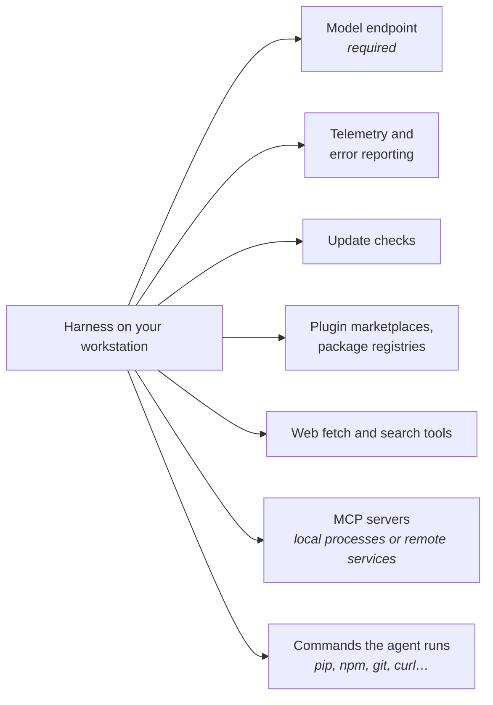
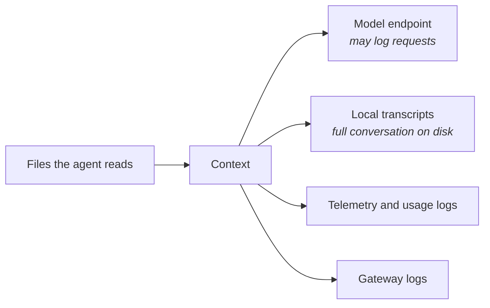

# Module 6: Running a Harness on an Air-Gapped Network

**Prerequisites:** your environment setup lesson (endpoint addresses, credentials, certificates, proxies), and [Module 2](../02-hard-controls/README.md)

Your setup lesson gets a harness talking to the internal model endpoint. This module is about everything *else* a harness does on the network, and what changes when the model, the tools, and the extensions all live inside an isolated environment. The guiding rule: **measure what the harness actually does; don't assume from its configuration.**

## Learning objectives

By the end of this module, you can:

1. List the network destinations a harness may contact besides the model endpoint, and how each behaves offline.
2. Audit a harness's real outbound traffic with an egress-logging proxy.
3. Check a self-hosted model's fitness for agent work before relying on it.
4. Identify where agent data (context, transcripts, logs) is stored and sent inside the enclave.
5. Bring extensions across the boundary in a controlled, reviewable way.

---

## 1. What a harness reaches for



| Destination | What happens when it's unreachable | What to do |
|---|---|---|
| **Model endpoint** | Nothing works | Point it at the internal endpoint or gateway (your setup lesson) |
| **Telemetry, error reporting** | Retries, log noise, sometimes slow startup | Disable, or redirect to an internal collector (Module 7) |
| **Update checks, auto-update** | Errors or delays at startup; partial updates | Disable; distribute versions through your internal software process |
| **Plugin marketplaces** | Install and refresh failures | Block the public defaults in managed settings; host an internal marketplace (Module 5) |
| **Web fetch and search tools** | Tool errors the model has to work around; sometimes long timeouts | Deny the tools in permission rules so the model doesn't try |
| **MCP servers launched with `npx` or `uvx`** | The server never starts (it tries to download itself) | Package the server and its dependencies inside the enclave; launch it from a local path |
| **Commands the agent runs** | `pip install`, `npm install`, `git clone` from public hosts fail or hang | Point package managers at internal mirrors; tell the agent in the instructions file which mirror to use |

Not all of these are obvious from documentation, and harness versions change what they contact. That's what the next lab is for.

---

## 2. Lab A: Audit a harness's egress

[`egress_logger.py`](egress_logger.py) is a small forward proxy (standard library only). It tunnels connections to hosts you allow and refuses and logs everything else. Any harness that honors `HTTPS_PROXY` (most do) can be run through it.

**Step 1. Start the logger,** allowing only your model endpoint's host:

```bash
python3 egress_logger.py --port 8899 --allow llm.internal.example
```

**Step 2. Run a harness through it** in a second terminal. Set both upper- and lower-case proxy variables, because tools differ in which they read, and clear `NO_PROXY` so nothing bypasses the logger:

```bash
../../practice-app/setup.sh ~/lab6
export HTTPS_PROXY=http://127.0.0.1:8899 HTTP_PROXY=http://127.0.0.1:8899
export https_proxy=$HTTPS_PROXY http_proxy=$HTTP_PROXY
unset NO_PROXY no_proxy
python3 ../../mini-harness/harness.py --workdir ~/lab6 --backend openai \
    --base-url https://llm.internal.example/v1 --model <model> --prompt "List the files."
```

**Step 3. Stop the logger** with Ctrl-C to see its summary. For mini-harness, you should see one host: the model endpoint. Read `backends.py` and confirm there's no other network code. That's the baseline: a harness that does only what you can see.

**Step 4. Repeat with your production harness.** We ran this lab with Claude Code 2.1.296 in non-interactive mode, with `ANTHROPIC_BASE_URL` pointing at an internal-style address and only that address allowed:

```text
summary (default settings)
  ALLOWED 127.0.0.1:8765        x17
  DENIED  api.anthropic.com:443 x17

summary (CLAUDE_CODE_DISABLE_NONESSENTIAL_TRAFFIC=1)
  ALLOWED 127.0.0.1:8765        x16
```

Redirecting the model endpoint did not, by itself, stop all traffic to the vendor's public host. One documented setting did. Your results will depend on the version, the mode (interactive sessions do more at startup), and the features in use, which is why this is a lab and not a table: **re-run it after every harness upgrade.**

> On a true air gap, denied traffic goes nowhere, but it still costs you: retries, timeouts, slow startups, and noise in network-monitoring alerts that can hide a real problem. Turn off what you don't need.

**Also audit what the agent's commands reach.** Ask the agent to run the practice app's tests, then something that installs a package. The logger shows every host those commands try, including ones you didn't anticipate in your package-mirror configuration.

---

## 3. Lab B: Is the internal model fit for agent work?

Agent work depends on capabilities a chat interface doesn't exercise. Before a team relies on a self-hosted model, check each one with mini-harness and the practice app:

| Capability | How to check | What failure looks like |
|---|---|---|
| **Tool calling** | Run the `investigate` task against the real endpoint | The model describes tool calls in prose instead of making them; the harness sees no `tool_use` blocks |
| **Valid arguments** | Watch the tool lines in the output | `_unparseable_arguments`, wrong parameter names, missing required fields |
| **Following results** | Does it use the tool output correctly? | Ignores the test failure, or invents file contents it never read |
| **Context length** | Use `/context` as the session grows; set `--context-limit` to the model's real limit | Server errors on long requests, or silently truncated input |
| **Prompt caching** | Run the usage report (Module 7) on a multi-step session | Zero cache reads: every request is processed from scratch, so long sessions are slow |
| **Speed** | `duration_ms` in the usage log | Multi-second latency per request multiplies across dozens of loop iterations |

Many self-hosted model servers need tool calling switched on explicitly (a server flag or a model-specific chat template). If the model never calls tools, check the server configuration before blaming the model.

**Why this matters for safety, not just quality:** a model that calls tools unreliably produces more confused requests, more permission prompts, and more "approve to get past it" fatigue. Weak tool use weakens the human-in-the-loop controls from Module 2.

---

## 4. Where agent data goes inside the enclave

"It never leaves the network" isn't the end of the data-handling question. Inside the enclave, agent data moves and persists in several places:



| Location | What it holds | Questions to answer |
|---|---|---|
| **Model endpoint** | Every request: system prompt, files read, command output | Is the endpoint accredited for the most sensitive data the agent can read? Does it log request bodies, and who can see them? |
| **Gateway** | Request metadata, often bodies | Same questions; gateways are often logged more broadly than the endpoint |
| **Local transcripts** | The full conversation, saved by the harness for resume and history | Where are they stored, for how long, and are they covered by the same handling rules as the source data? (Claude Code, for example, keeps session history locally and cleans it up after a configurable number of days.) |
| **Telemetry** | Token counts, tool names; optionally prompts, commands, and raw bodies | Which content options are on? Prompts are redacted by default in Claude Code's telemetry; raw API bodies contain everything |
| **Usage logs** | File paths and full commands (mini-harness) | Treat as sensitive operational data |

**The working directory is the classification boundary in practice.** An agent started in a folder can read everything under it (Module 2), and everything it reads goes to the endpoint and into the transcript. Start agents in the narrowest folder that contains the task.

---

## 5. Bringing extensions across the boundary

On a connected network, extensions arrive with a single command. On an air gap, every one crossed the boundary through a deliberate process, and that process is your supply-chain control.

| Item | Risk | Practice |
|---|---|---|
| Harness binary and updates | Behavior changes between versions (Lab A) | Pin versions; re-run the egress audit and your hard-control tests on each upgrade |
| Plugins and marketplaces | Hooks and servers run as the user; descriptions enter context | Review like code; host in an internal marketplace with pinned versions (Module 5) |
| MCP servers | Their own process, credentials, and network reach | Vendor the dependencies; no runtime downloads; review tool descriptions |
| Skills | Instructions and scripts | Review the scripts; check descriptions for injection-style text |
| Packages the agent suggests | A dependency that doesn't exist in your mirror, or a look-alike name | Agents should only install from the internal mirror; review every new dependency in the diff (Module 4) |

Record for each item: what it is, its version, where it came from, who reviewed it, and when. When something behaves unexpectedly, that record is how you find out what changed.

---

## 6. In a production harness

For Claude Code, the documentation's enterprise network configuration and data-usage pages are the reference to bring across the boundary with the software. The settings most relevant beyond basic endpoint setup:

| Need | Setting |
|---|---|
| Route model traffic to an internal gateway | `ANTHROPIC_BASE_URL` (or the cloud-provider integrations your setup lesson uses) |
| Corporate proxy and certificate authority | `HTTPS_PROXY`, `NO_PROXY`, `NODE_EXTRA_CA_CERTS`; client certificates with `CLAUDE_CODE_CLIENT_CERT` and `CLAUDE_CODE_CLIENT_KEY` |
| Stop nonessential traffic (telemetry, error reporting, and similar) | `CLAUDE_CODE_DISABLE_NONESSENTIAL_TRAFFIC=1`; individually, `DISABLE_TELEMETRY` and `DISABLE_ERROR_REPORTING` |
| Keep the agent off the web | Deny `WebFetch` and `WebSearch` in permission rules; note that WebFetch performs a domain safety check against the vendor API unless `skipWebFetchPreflight` is set |
| Control plugins | Managed settings can allowlist marketplaces and block the public default |
| Enforce all of the above | Put them in **managed settings**, which users and repositories can't override, and use the `env` block so background sessions inherit them |

Verify each one with the Lab A audit rather than trusting the configuration alone.

---

## Readiness checklist

Before a team uses a harness on the air gap, confirm:

- [ ] The egress audit shows only approved destinations, for the exact harness version deployed.
- [ ] Nonessential traffic, update checks, and public marketplaces are disabled through managed settings.
- [ ] The internal model passes the Lab B checks: tool calling, valid arguments, context length, acceptable latency.
- [ ] The endpoint and any gateway are approved for the most sensitive data agents can read, and their request logging is understood.
- [ ] Transcript and telemetry storage locations and retention match your data handling rules.
- [ ] Package managers point at internal mirrors, and the instructions file says so.
- [ ] Every extension has a provenance record and a pinned version.
- [ ] Hard controls from Module 2 (deny rules, hooks, sandbox) are deployed through managed settings and tested.

---

## Check your understanding

**1. You set the model endpoint to the internal gateway. Why still run an egress audit?**

> **Answer:** The endpoint is one destination among several. Telemetry, update checks, marketplaces, web tools, and the agent's own commands may still try to reach other hosts, and harness versions change what they contact. Lab A's result is an example.

**2. Denied connections can't leave an air gap. Why bother disabling them?**

> **Answer:** They still cause retries, timeouts, slow startups, and monitoring noise, and they show the harness assumes connectivity you don't have. Disabling them makes behavior predictable and real anomalies visible.

**3. The internal model never calls tools; it describes what it would do in prose. What do you check first?**

> **Answer:** Whether tool calling is enabled on the model server (often a flag or a chat template). If it is, the model may not be suitable for agent work.

**4. Everything stays inside the enclave. Name two places a file the agent read may now persist.**

> **Answer:** Any two of: the model endpoint's or gateway's request logs, the harness's local transcript, telemetry (if content logging is on), and the usage log.

---

### Key takeaway

> **Inside an air gap, the question changes from "can data leave?" to "where does data go, and what does the harness assume?" Answer both by measuring.**
