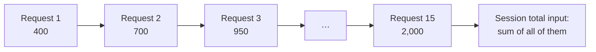

# Module 7: Token Usage Observability

**Prerequisites:** [Module 1](../01-build-a-harness/README.md), [Module 3](../03-context-engineering/README.md)

Every behavior in this course shows up in token counts: re-sent history, large tool results, bloated instructions, compaction, loops. Learning to read usage data turns "the agent feels slow and expensive" into a specific cause you can fix. On an air-gapped network the model endpoint is usually a shared internal resource, so tokens are capacity: every wasted token is GPU time and queue delay for everyone else on the endpoint.

## Learning objectives

By the end of this module, you can:

1. Name the four kinds of tokens a request uses and how each is counted.
2. Explain why a session's total input grows much faster than its context.
3. Read a usage report and identify the biggest driver of a session's cost.
4. Set up usage telemetry for a production harness, including on an air-gapped network.

---

## 1. The four token counts

Every request reports usage in up to four parts:

| Count | What it is | Typical relative cost |
|---|---|---|
| **Input** (uncached) | Request content processed fresh | Baseline |
| **Cache write** | Input processed fresh *and* stored for reuse | Slightly more than input |
| **Cache read** | Input served from a stored prefix | A small fraction of input |
| **Output** | Text and tool calls the model generates, including any reasoning | Several times input |

**How caching works:** the model server stores the processed form of a request's beginning, its *prefix*. If the next request starts with exactly the same tokens, that part is reused instead of recomputed. Because harnesses resend the whole conversation, and only append to the end, most of each request is a prefix of the previous one. A healthy long session serves most of its input from cache.

The cache breaks when the prefix changes:

- the system prompt or tool list changes (for example, an MCP server is added mid-session),
- compaction rewrites earlier messages,
- the session sits idle longer than the cache's lifetime (often minutes),
- the request goes to a different server that doesn't hold the cache.

Self-hosted model servers often implement the same idea under the name "prefix caching." Whether it's on, and whether usage responses report it, depends on the server.

---

## 2. Why usage climbs

From Module 1: request *n* contains everything from requests 1 to *n*−1, plus new results. So the **total input over a session** is the sum of every request's context size, not the size of the final context.



The two scripted sessions from earlier modules show the effect (estimated tokens):

| Session | Requests | Final context | Total input | Ratio |
|---|---|---|---|---|
| `investigate` (focused question) | 5 | ~1,200 | ~4,300 | 3.5× |
| `long-session` ("review the whole project") | 15 | ~2,000 | ~21,000 | 10.3× |

Three times as many requests produced five times the input. That's the cost of a broad request, and why Module 3 recommends specific prompts and short sessions.

---

## 3. Lab A: Read a usage report

mini-harness logs every request and tool call to `<workdir>/.mini-harness/usage.jsonl`. The report script in this folder summarizes it. From the `mini-harness` folder:

```bash
../practice-app/setup.sh ~/lab7
python3 harness.py --workdir ~/lab7 --scenario scenarios/investigate.json --prompt "Why is the login test failing?" < /dev/null
python3 harness.py --workdir ~/lab7 --scenario scenarios/long-session.json --context-limit 2500 \
    --prompt "Review the whole project." < /dev/null
python3 ../modules/07-token-observability/usage_report.py ~/lab7/.mini-harness/usage.jsonl
```

(`< /dev/null` makes any permission prompt answer "no", so the runs finish without input.)

The report for the long session includes:

```text
requests: 15   tool calls: 14   compactions: 4
growth:   first request 409 -> last request 2,044 input tokens; total input over the session 21,078 (10.3x the final context size)

context per request (input tokens processed, share served from cache, tools requested)
    1 ########                                     409    -  list_files
    ...
    8 ######################################     1,928    -  read_file  <- compacted after this
    9 #######################                    1,199    -  run_command
    ...
repeated calls (same tool, same target)
  3x  run_command(python3 run_tests.py)
  2x  read_file(src/auth.py)
  2x  read_file(tests/test_login.py)
  2x  read_file(run_tests.py)
```

Read it top to bottom and answer:

1. **What drives the cost?** Volume: 15 requests, with tool results accumulating until compaction.
2. **What does "compacted after this" show?** The context drops sharply on the next request, and the agent then re-reads files it had already read. That's compaction's hidden cost: lost details get fetched again.
3. **What do the repeated calls tell you?** Work the agent did more than once. Running the full verbose test suite three times is a candidate for a condensed script (the skill in Module 5).

The mock's token counts are estimates (about 4 characters per token) and it reports no caching. A real backend reports exact counts and cache fields.

---

## 4. Lab B: Find the cache miss

[`examples/sample-cached-session.jsonl`](examples/sample-cached-session.jsonl) is an **illustrative** log, shaped like a real cached session (the numbers are made up for teaching):

```bash
python3 usage_report.py examples/sample-cached-session.jsonl
```

```text
cache:    82% of input was read from cache

    6 #################################         11,925  94%  edit_file
    7 ##################################        12,000   0%  run_command  <- cache miss: whole context re-processed
    8 ###################################       12,510  96%  read_file
```

Request 7 re-processed its whole 12,000-token context. In this log, the session was idle for ten minutes before it, longer than the cache lifetime. Other common causes are listed in section 1.

**Discuss:** A developer leaves a long session open over lunch and asks one quick question afterward. Why is that question expensive? (The whole history is re-sent, and it misses the cache. A fresh session with a handoff note would have been cheaper.)

---

## 5. Lab C: Reduce a session's tokens

Pick one change at a time, re-run the same scenario on a fresh copy, and compare reports:

| Change | How | Expected effect |
|---|---|---|
| Shorter instructions file | Module 3's bloated vs. short `AGENTS.md` | Lower cost on **every** request |
| Smaller tool output | Lower `max_output_chars` in the policy, or condense with a script | Smaller results, slower context growth |
| Narrower request | Name the file and the done-condition | Fewer requests |
| Fresh session per task | `/clear`, or a new run with a handoff note | Resets the growth curve |

Record what you changed and the before and after totals. You now have evidence for your team's usage guidance, rather than rules of thumb.

---

## 6. What to watch, and what to protect

For a team, the useful signals are:

| Signal | Usually means |
|---|---|
| High requests per completed task | Vague prompts, or the agent going in circles |
| Low cache share | Idle gaps, frequently changing tools or instructions, or caching not enabled on the endpoint |
| Large single tool results | Unfiltered logs or test output; whole-file reads of big files |
| Many compactions per session | Sessions running too long |
| Repeated identical calls | Lost context (after compaction) or a looping agent |
| Sessions hitting the step limit | A stuck agent; review the transcript |

**Usage data is sensitive.** The mini-harness log contains file paths and full commands. Transcripts contain code and anything the agent read. Store and retain them according to the classification of the data the agent worked on, not as generic application logs.

---

## 7. In a production harness

Claude Code provides observability at three levels:

**In the session.** `/usage` shows the session's token totals by model, including cache reads and writes, and a prompt-cache line summarizing how much input came from cache, misses, and whether the cache is still warm. `/context` shows what's occupying the context window. A custom status line can display context use continuously. Cost figures are estimates, at list price unless an administrator configures contracted rates with the `modelPricing` managed setting.

**Across a team, with OpenTelemetry.** Claude Code can export metrics and events to a collector you run, which works on an isolated network:

```bash
export CLAUDE_CODE_ENABLE_TELEMETRY=1
export OTEL_METRICS_EXPORTER=otlp           # or prometheus, console, none
export OTEL_LOGS_EXPORTER=otlp              # events
export OTEL_EXPORTER_OTLP_PROTOCOL=grpc
export OTEL_EXPORTER_OTLP_ENDPOINT=http://otel-collector.internal:4317
```

| Signal | Name | Useful attributes |
|---|---|---|
| Token metric | `claude_code.token.usage` | `type` = `input`, `output`, `cacheRead`, `cacheCreation`; `model` |
| Cost metric (estimated) | `claude_code.cost.usage` | `model` |
| Per-request event | `claude_code.api_request` | input, output, and cache token counts; duration |
| Per-tool event | `claude_code.tool_result` | tool name, success, duration, result size |
| Permission event | `claude_code.tool_decision` | accept or reject, and whether it came from config, a hook, or the user |

With `OTEL_METRICS_EXPORTER=prometheus`, metrics are served locally for scraping (default port 9464), which avoids running a collector for a small pilot.

**Privacy defaults.** Prompt text is redacted from events by default (`OTEL_LOG_USER_PROMPTS` turns it on). Options to log tool details, tool output, or full raw API bodies exist; raw bodies contain the entire conversation, so enable them only where your data handling rules allow it. Administrators can pin the telemetry destination in managed settings so it can't be redirected per project.

**Behind a gateway.** If all model traffic goes through an internal LLM gateway, the gateway's own request logs give per-user and per-key token counts regardless of which harness each developer uses.

---

## Check your understanding

**1. A session's final context is 20,000 tokens. Why might its total input be 300,000?**

> **Answer:** Every request re-sends the context accumulated so far. Total input is the sum over all requests, so it grows much faster than the context, roughly with the square of the number of steps.

**2. Most of a long session's input shows as cache reads. Is the session cheap?**

> **Answer:** Cheaper per token, not free: cache reads are still billed or still use endpoint capacity, the window is still full, and output tokens aren't cached. Long sessions remain expensive; caching softens it.

**3. The report shows `read_file(src/auth.py)` three times in one session. What are two likely explanations?**

> **Answer:** Compaction removed the earlier read, so the agent fetched it again; or the file changed and the agent re-checked it. The compaction markers in the report tell you which.

**4. Why redact prompts from telemetry by default?**

> **Answer:** Prompts and tool output can contain code, data, and secrets. Telemetry pipelines are often retained longer and accessed more widely than the source systems, so they shouldn't hold content unless policy allows it.

---

### Key takeaway

> **Every request carries everything before it. Measure the curve, find what bends it upward, and fix that.**
